# Checkpoint A · Compact harbor, island, and ridge

The captures use synthetic data and the local browser renderer. The November 25 review authorized the synthetic ridge comparison.

| Previous overview | Compact overview |
| --- | --- |
| 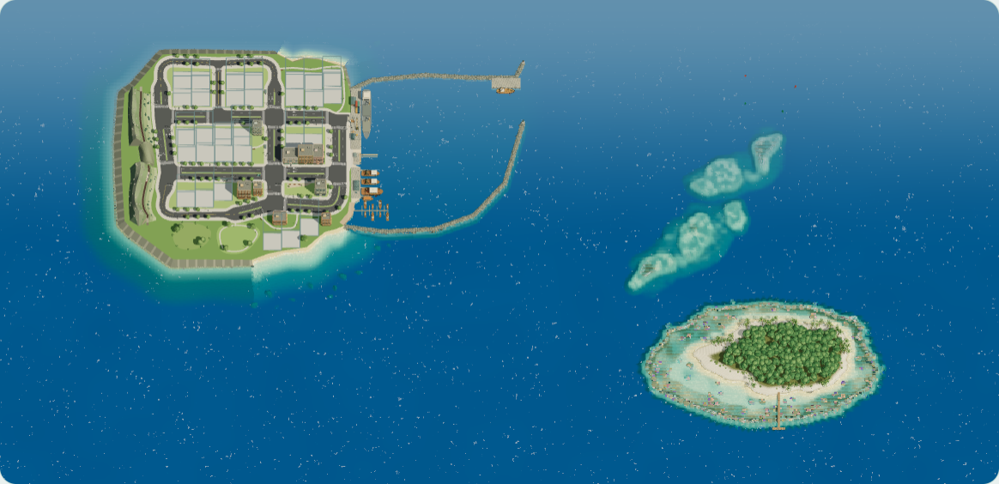 | 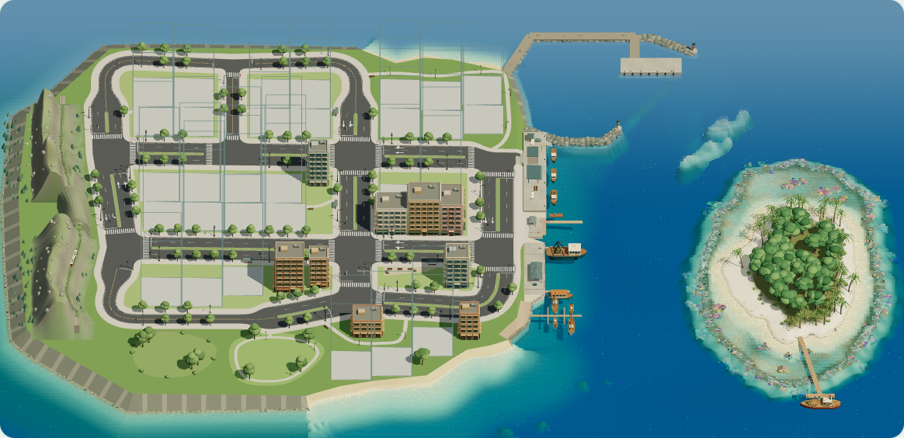 |

| Scene | Day | Night |
| --- | --- | --- |
| World | 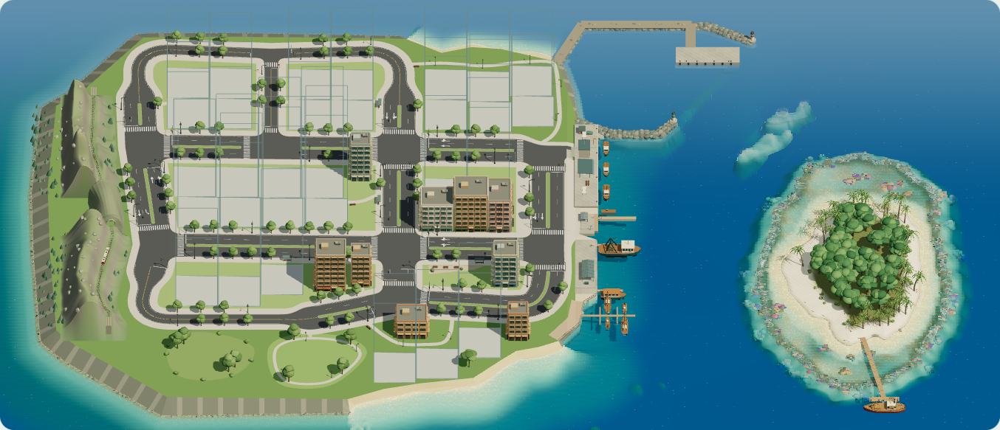 | 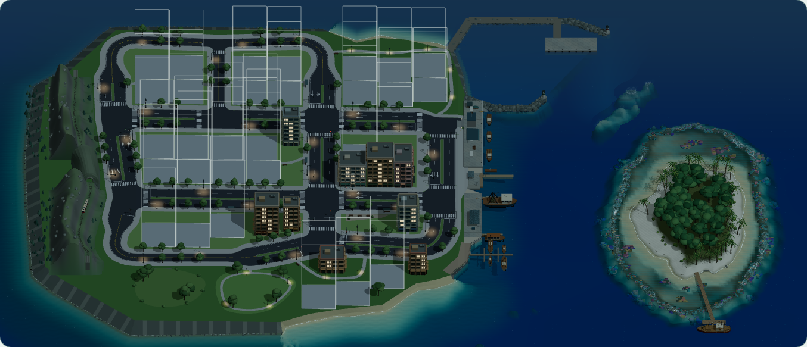 |
| Harbor | 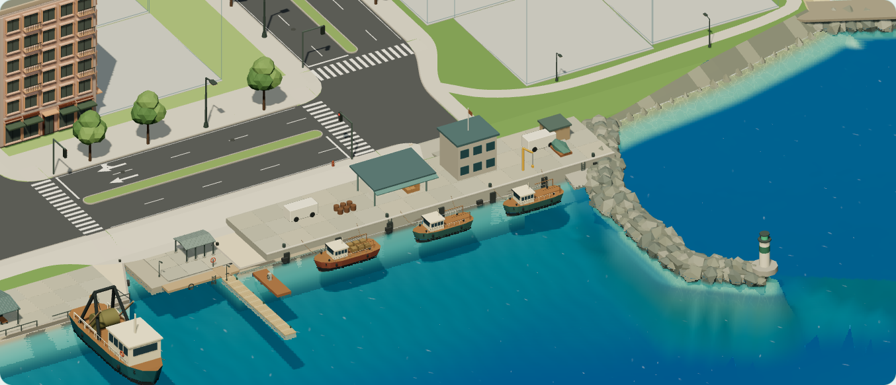 | 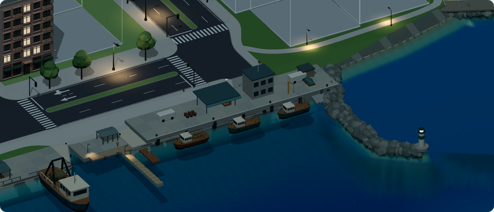 |
| Four hours asleep | 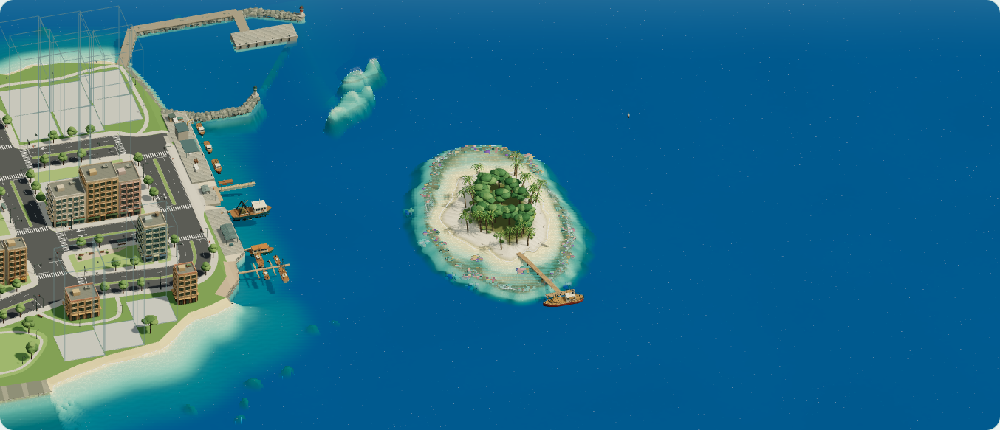 | 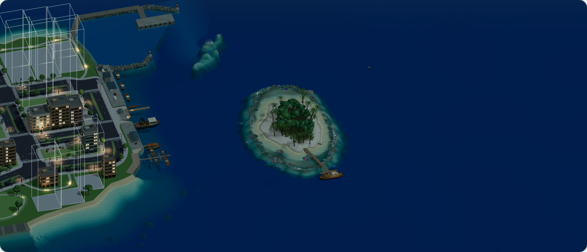 |
| Eight hours asleep | 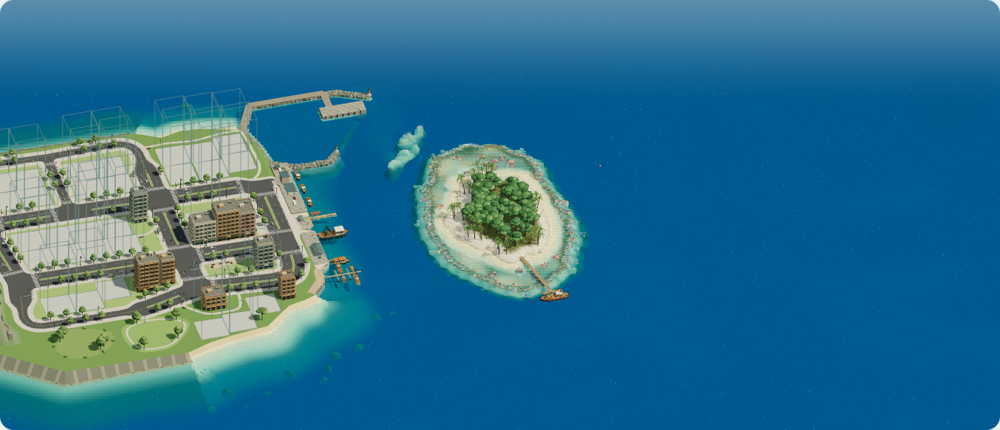 | 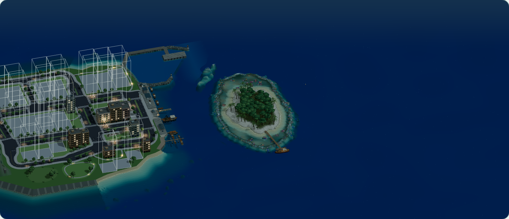 |
| Twelve hours asleep | 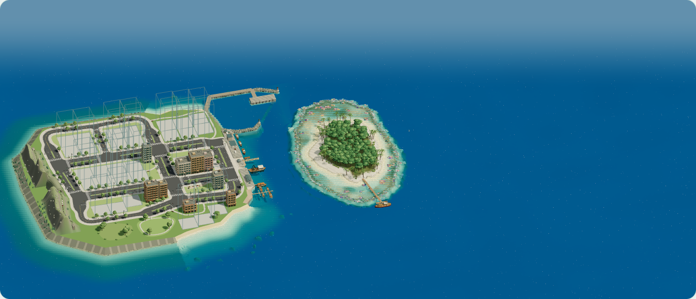 | 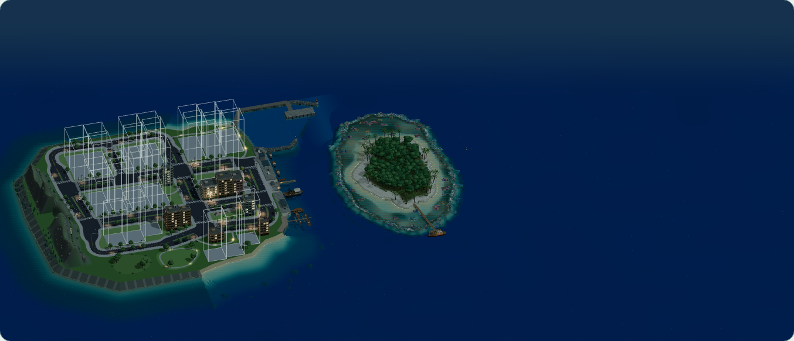 |

| Ridge view | Before | After |
| --- | --- | --- |
| Heart focus | 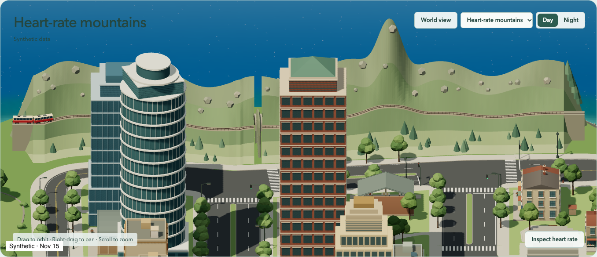 | 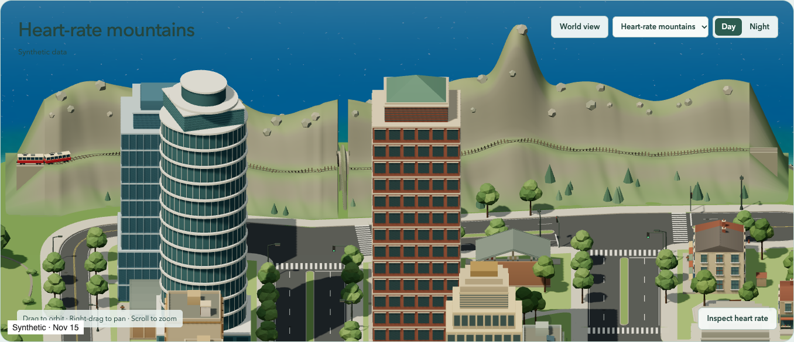 |
| Low side | 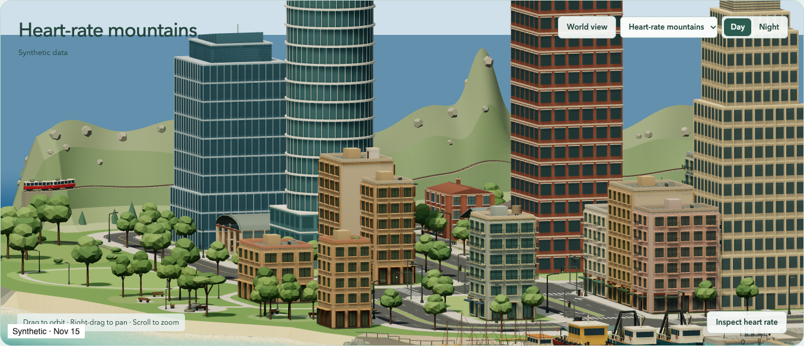 | 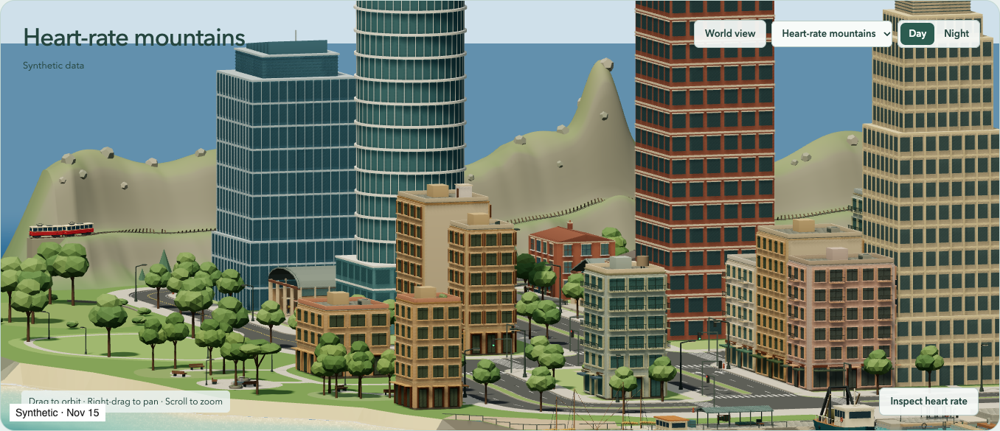 |

The mainland measures 54,363.95 m² inside the coastline. Twelve hours asleep produces 7,200 m² of land and an 18,000 m² reef platform.
The breakwater centerlines span 92 × 71 m. The basin radius is 18 m.
The boat passes the mouth at 22.50 m and completes its starboard slide at 401.31 m.
After the harbor exit, the representative voyage covers 3.51 m per second of screen time at 240× during steady travel.

## Mist during the voyage

These earlier captures show the first shoreline adjustment on a synthetic voyage with a 12-hour island.

| Camera | Original mist | First shoreline adjustment |
| --- | --- | --- |
| World during the voyage | 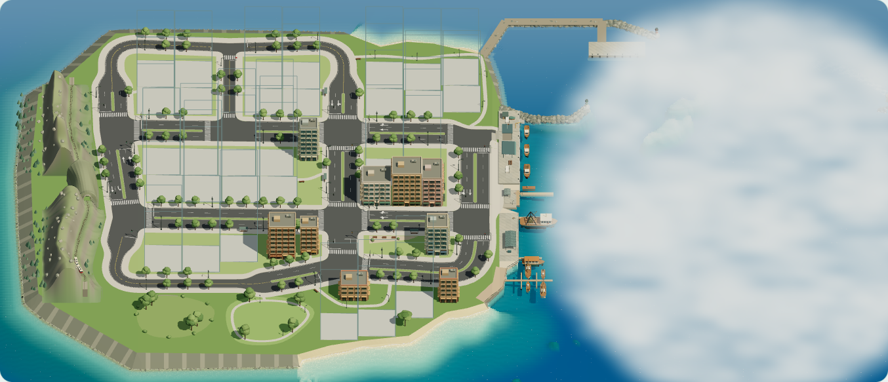 | 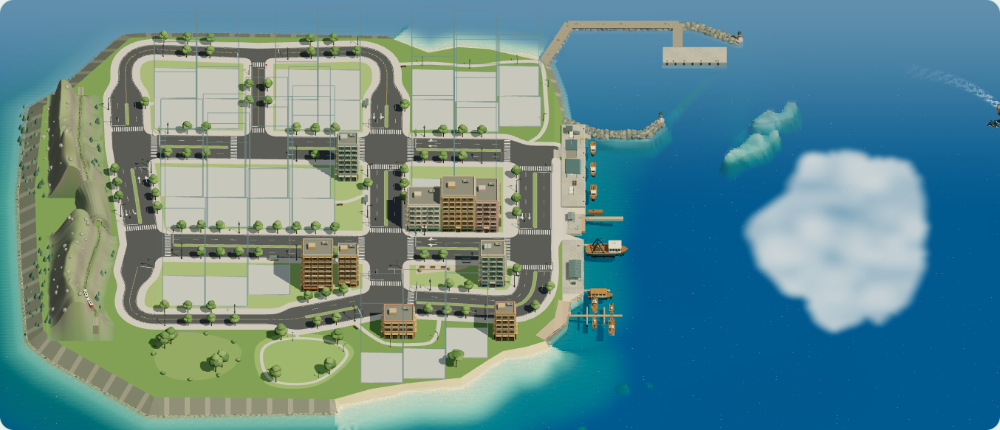 |
| Boat on approach | 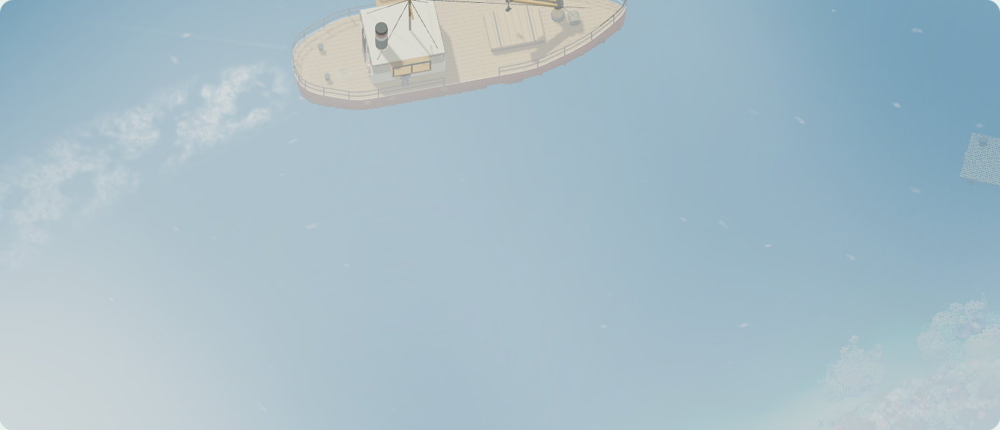 | 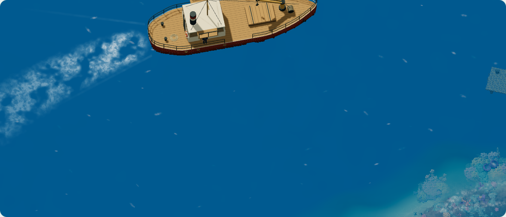 |

## Current mist and island camera

The mist moves across the island in translucent patches 1.5 m above the water. Three overlapping bands extend downwind over the water. Their size depends on the daily island area. The island, jetty, reef, and seabed are visible from the first frame. The island camera frames the shoreline and jetty when the user selects the view. The camera keeps the selected zoom and angle through arrival and departure.

| Four hours asleep, initial view | Twelve hours asleep, initial view | Island after arrival |
| --- | --- | --- |
| 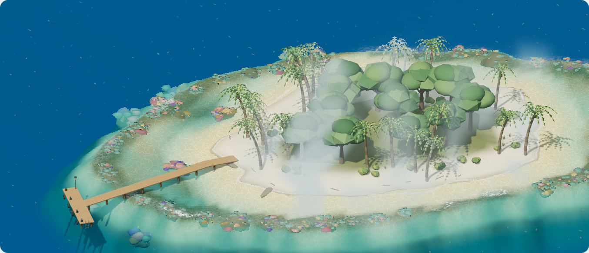 | 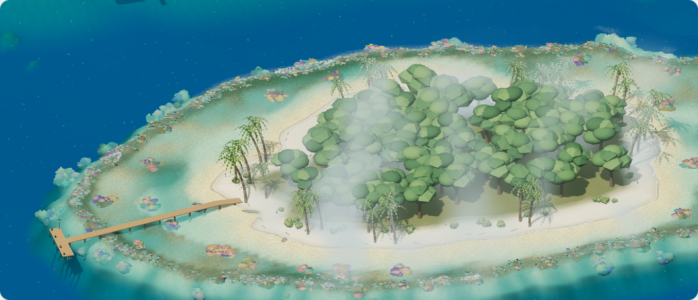 | 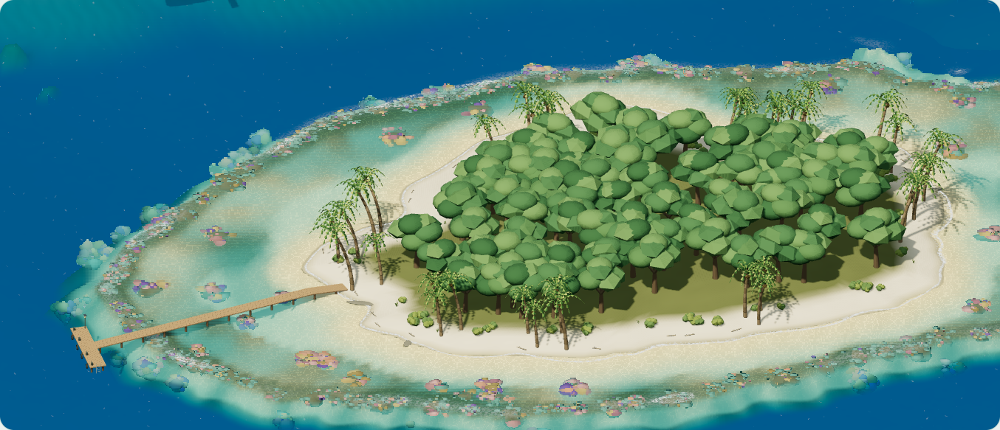 |

At 05:28:20 in the synthetic replay, the whale swims above the edge of the destination reef. Its submerged torso remains visible. [Whale above the reef](whale-over-reef.png)
