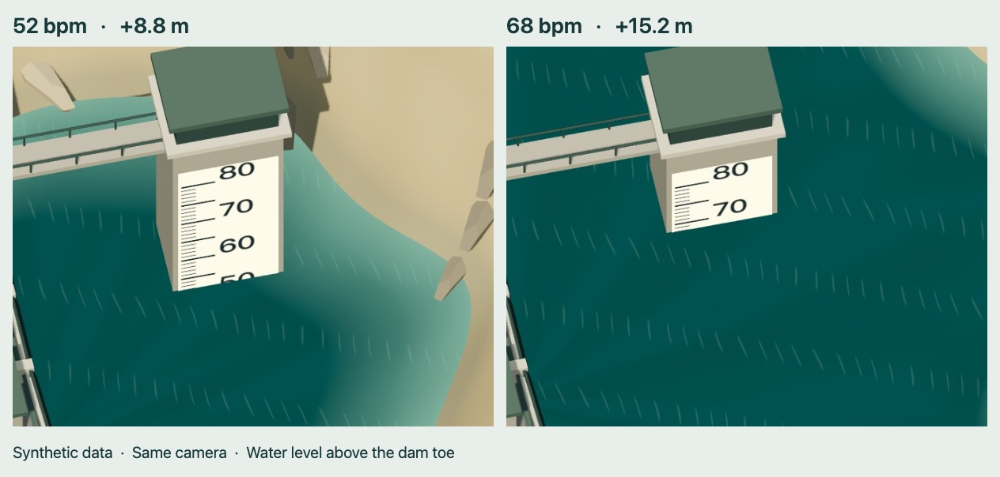

# Checkpoint D · Site A reservoir

The curved dam occupies the north-west ridge saddle. Its toe is at world coordinates (−218, 5.25, 148). The crest road is 70 m long and 22 m above the toe. The full water surface measures 71 m × 43 m. The north-west shore extends around the outlet. At least 6 m of grass separates the bank from the sidewalk along Valley Lane. [Street and reservoir from above](street-clearance.jpg)

## World and focus

These browser captures use synthetic daily records on the recorded-data path. All four views include the maximum HRV build of 30 towers. The focus card and the intake gauge show the same daily RHR.

| Lighting | World | RHR focus |
| --- | --- | --- |
| Day | [Overview](day-world.jpg) | [Dam and lake](day-focus.jpg) |
| Night | [Overview](night-world.jpg) | [Crest lamps and intake tower](night-focus.jpg) |

## Water level

Each bpm moves the waterline by 0.4 m between 40 and 80 bpm. The intake gauge has a tick for each bpm. The pale band along the shore grows as the level falls. Changing the replay time keeps the daily level fixed.

| Daily RHR | Level above toe | Gauge view |
| --- | --- | --- |
| 52 bpm | 8.8 m | [52 bpm](gauge-52.jpg) |
| 60 bpm | 12.0 m | [60 bpm](gauge-60.jpg) |
| 68 bpm | 15.2 m | [68 bpm](gauge-68.jpg) |
| 84 bpm | 20.0 m | [Upper limit and exact card value](gauge-84.jpg) |

## Unavailable readings

The dam remains visible. The closed gauge and translucent capacity outline show that the daily level is unknown. A day with both sleep and awake readings uses the sleep reading. The disagreement fixture uses two different readings from the same preferred method.

[No reading](gauge-missing.jpg) · [Read failure](gauge-failed.jpg) · [Unresolved same-method readings](gauge-conflict.jpg)

## Rendering cost

Local Chrome rendered the 30-tower fixture at 1440 × 900. Each sample covers 110 animation frames after 55 warm-up frames. Draw calls and triangles are peak counts. The median frame interval was 16.7 ms in all four samples.

| World view | Calls with dam hidden | Calls with dam visible | Triangles with dam visible |
| --- | ---: | ---: | ---: |
| Day | 273 | 279 | 1,304,754 |
| Night | 278 | 287 | 1,318,096 |

Both views fit the city limits of 350 calls and 2.5 million triangles. These measurements cover the whole frame. They do not isolate GPU time for the glass interface.
