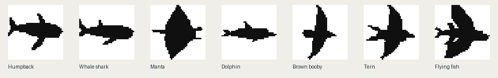

# Checkpoint E · Marine wildlife

**Approved by the user on November 24, 2026.** This checkpoint covers seven stylized animals. The voyage uses the synthetic November 11–12 session. [Review 1, section 4](../../../../docs/plans/sleep-voyage-v3-review-1.md#4-animals)

## Voyage, close views, and motion

Open the voyage view to judge size beside the 20 m working boat. The close view follows the subject. Each day and night pair uses the same replay instant. The recordings show the running scene in daylight. Chicago time crosses midnight after the first row.

| Animal | Replay time | Voyage | Close view | Motion | Earlier reference |
| --- | --- | --- | --- | --- | --- |
| Brown booby | 23:31:40 | [Day](booby-voyage-day.png) · [Night](booby-voyage-night.png) | [Day](booby-close-day.png) · [Night](booby-close-night.png) | [Play](booby.webm) | [Checkpoint C](../checkpoint-c/flock-day.png) |
| Tern | 02:30:00 | [Day](tern-voyage-day.png) · [Night](tern-voyage-night.png) | [Day](tern-close-day.png) · [Night](tern-close-night.png) | [Play](tern.webm) | [Checkpoint C](../checkpoint-c/flock-day.png) |
| Flying fish | 02:30:00 | [Day](flying-fish-voyage-day.png) · [Night](flying-fish-voyage-night.png) | [Day](flying-fish-close-day.png) · [Night](flying-fish-close-night.png) | [Play](flying-fish.webm) | [Checkpoint C](../checkpoint-c/flying-fish-day.png) |
| Dolphin | 01:38:20 | [Day](dolphin-voyage-day.png) · [Night](dolphin-voyage-night.png) | [Day](dolphin-close-day.png) · [Night](dolphin-close-night.png) | [Play](dolphin.webm) | [Checkpoint C](../checkpoint-c/dolphin-pod-day.png) |
| Manta ray | 01:44:50 | [Day](ray-voyage-day.png) · [Night](ray-voyage-night.png) | [Day](ray-close-day.png) · [Night](ray-close-night.png) | [Play](ray.webm) | [Checkpoint C](../checkpoint-c/manta-day.png) |
| Whale shark | 01:38:20 | [Day](shark-voyage-day.png) · [Night](shark-voyage-night.png) | [Day](shark-close-day.png) · [Night](shark-close-night.png) | [Play](shark.webm) | [Checkpoint C](../checkpoint-c/whale-shark-day.png) |
| Humpback whale | 05:12:10 | [Day](whale-voyage-day.png) · [Night](whale-voyage-night.png) | [Day](whale-close-day.png) · [Night](whale-close-night.png) | [Play](whale.webm) | [Checkpoint C](../checkpoint-c/whale-spout-day.png) |

The manta and humpback appear in the first and second REM encounters. The shark and dolphin captures use the existing development species selector. The selector retains the voyage camera, water, and encounter timing. The flying fish capture uses the ordinary LIGHT stage at 02:30.

## Surface sequences

| Action | Chicago time | Captures | Visual check |
| --- | --- | --- | --- |
| Humpback blow | 05:20:03 | [Day](whale-blow-day.png) · [Night](whale-blow-night.png) | A bushy column spreads above the exposed back. |
| Fluke dive | 05:22:01 | [Day](whale-flukes-day.png) · [Night](whale-flukes-night.png) | The head descends into blue water as the flukes rise. |
| Breach | 05:30:16 | [Day](whale-breach-day.png) · [Night](whale-breach-night.png) | The body pitches out of the water. The recording continues through reentry and spray. |
| Dolphin bow ride | 01:38:20 | [Day](dolphin-voyage-day.png) · [Night](dolphin-voyage-night.png) | The lead group travels immediately ahead of the bow. The other dolphins porpoise beside the boat. |
| Manta barrel roll | 01:46:16 | [Day](ray-roll-day.png) · [Night](ray-roll-night.png) | The pale belly turns toward the camera once during the encounter. |

## Size and identification

The silhouette strip uses triangles from the exported GLB. Each projection fits in 40 × 40 pixels. The strip enlarges these pixels for inspection. Projected spans in the table use the normal voyage camera in a 1250 × 870 Chrome viewport. The canvas occupies 1164 × 564 CSS pixels. For the flock and flying fish, the measurement uses a fully visible individual. For dolphins, it uses the smallest extent across the pod.

| Animal | Rendered dimension | Required | Measured | Reference comparison |
| --- | --- | ---: | ---: | --- |
| Brown booby | 2.8 m span | 55 px | 59.2 px | The pointed brown wings and wedge tail separate it from the fork-tailed tern. |
| Tern | 1.8 m span | 38 px | 40.8 px | The black cap, pale body, and two tail streamers remain visible in the close view. |
| Flying fish | 0.9 m long, 1 m span | 18 px | 19.4 px | The new fish has broad silver pectoral fins, blue upper skin, paired pelvic fins, and a forked tail. |
| Dolphin | 4 m long | 85 px | 91.5 px | Three animals ride the bow. The rest swim beside the boat. Their beaks and swept dorsal fins remain distinct. |
| Manta ray | 8 m span | 165 px | 177.8 px | The close view shows the shoulder markings. The roll exposes the pale belly, paired gill slits, and cephalic fins. |
| Whale shark | 12 m long | 250 px | 270.5 px | The broad snout, tall dorsal fin, longer upper tail lobe, pale bars, and spot rows identify the shark. |
| Humpback whale | 16 m long | 330 px | 355.1 px | White pectoral fins, head tubercles, a small dorsal hump, and wide flukes distinguish the humpback. |

## Runtime and verification

The GLB stores a head-to-tail weight on each vertex. The shader bends each animal from replay time. Wings use the distance from the wing root. Flying fish beat their tails during takeoff. Seabirds alternate flapping with gliding and cast soft shadows on the water. At night, nearby birds receive light from the deck lamps.

The water refraction pass draws each submerged fragment. The main pass draws the portions above the waterline. The silver fish school and its mesh are removed. The water, animal motion, and effects freeze when playback pauses. [Model builder](../../../../scripts/sleep-sea-life.mjs) · [Motion shader](../../../../src/scene/sleep/animal-motion.ts) · [Wildlife renderer](../../../../src/scene/sleep/wildlife-render.ts)

The GLB tests measure all seven animals and check triangle limits and vertex weights. The Chrome deformation test runs the production wave on exported head and tail or wingtip vertices. Between opposite phases, tip movement must reach 5% of the rendered dimension. Head movement must stay within 1%. Repeating a sampled time must restore the same GPU result. The water test compares rendered pixels with each pass isolated during a dive and a breach. [Asset tests](../../../../src/scene/sleep/assets.test.ts) · [GPU and water tests](../../../../tests/browser/wildlife.spec.ts)

The gallery contains 36 scene captures and seven WebM recordings. Chrome decoded all seven recordings and successfully sought between two different frames in each file. Clip durations range from 3.05 to 6.14 seconds. The ordinary synthetic replay supplies both REM encounters. Only the shark and dolphins need the development selector.

The unit suite passed all 205 tests. Four TypeScript projects passed type checking. The production build passed with the existing Vite chunk-size advisory. All 34 Chrome tests passed before the final manta gill and clearance revision. All three affected Chrome checks passed again after that revision.

## Rendering measurements

Chrome 158.0.8127.38 ran on an Apple M1 Pro with 16 GiB of memory at 240× replay. Each comparison used the same view, start time, and lighting. The baseline hid the wildlife group. The full sample included the animals, shadows, foam, and spray. Each sample used 57 frame intervals after eight warm-up frames.

| Voyage view | Day added calls / triangles | Night added calls / triangles | Day / night median frame interval |
| --- | ---: | ---: | ---: |
| LIGHT | 6 / 3,448 | 6 / 2,078 | 16.8 / 16.7 ms |
| Whale | 6 / 4,800 | 7 / 7,032 | 16.6 / 16.6 ms |
| Manta | 11 / 1,360 | 12 / 3,628 | 16.8 / 16.7 ms |
| Shark | 9 / 3,160 | 10 / 5,428 | 16.6 / 16.7 ms |
| Dolphins | 5 / 7,332 | 6 / 9,564 | 16.7 / 16.6 ms |

The daytime LIGHT and manta samples exceeded the 16.7 ms target by 0.1 ms. A repeat with 181 frame intervals per sample gave a median of 16.7 ms for both views, with wildlife visible and with wildlife hidden.

## Review boundary

The user approved Checkpoint E on November 24, 2026. Phase F covers the voyage card and remaining visual fixes. The dark card theme, multiple sessions on one day, and recorded Google Health sleep integration remain open.
