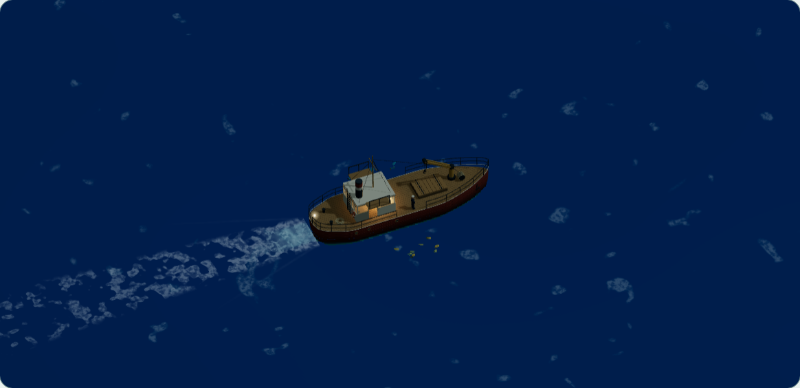
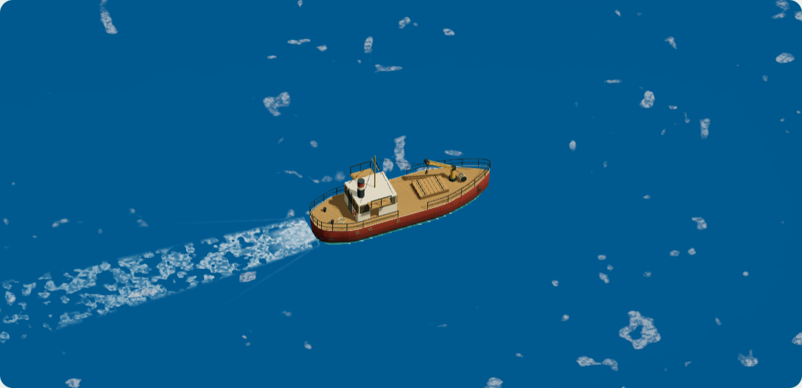
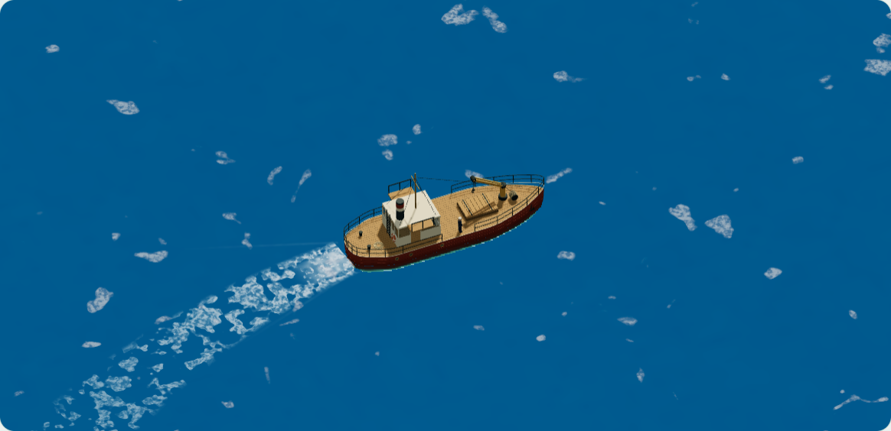
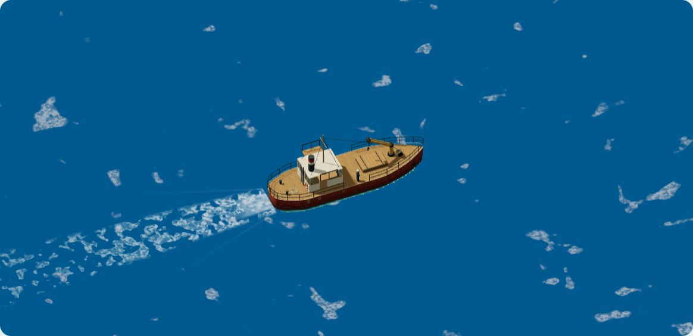

# Phase 2 · Open sea

The synthetic voyage follows a fixed 1,000.07 m route from the working berth to the island approach. The final 120 m runs straight. The boat continues 45 m beyond the landing before it turns offshore. The old island and its pier serve as the temporary destination until the island review.

## Browser captures

These frames use the **Sleep voyage** camera on November 12, 2026. Day and Night select the lighting independently of the Chicago replay clock.

| 01:31:40 · Outbound at night | 04:38:20 · Outbound by day |
| --- | --- |
|  |  |
| **06:47:30 · Offshore turn** | **07:00:00 · Return lane** |
|  |  |

The shallow seabed has two local textures, one for the city and one for the island. Between them, the floor depth is 40 m. The water surface follows the camera in 256 m steps. Ripples, flecks, and fish splashes keep their world positions. All sleep stages use the same open water.

## Route checks

| Measurement | Result |
| --- | ---: |
| Outer mouth along the outbound route | 36.50 m |
| Mean distance per ambient time unit over 442 asleep minutes | 7.16 m |
| Mean distance per screen second at 240× over those minutes | 9.05 m |
| Smallest sampled return radius outside the outer mouth | 62.27 m |
| Offshore lane separation from X = 335 m to the landing | ≥80 m |
| Pivot time in the turning basin | 972 replay seconds |
| Smallest buoy clearance during anchor swing, beyond the 1.5 m reserve | 0.216 m |

The two lanes converge on the shared outer mouth. The 80 m separation applies beyond the harbor approach. The boat has a separate forward departure at the island end. The buoy test includes its 0.51 m radius and the hull's swing about the bow.

## Rendering measurements

Chrome captured the paused views at a 1,250 × 870 browser viewport. Each measurement uses the median of 28 frame intervals after four warm-up intervals. Draw calls and triangles include the water pre-pass. These samples measure the current open sea. The completed island and moving wildlife require separate measurements.

| Frame | Median interval | Draw calls | Triangles |
| --- | ---: | ---: | ---: |
| Outbound, night | 16.7 ms | 223 | 51,918 |
| Outbound, day | 16.6 ms | 206 | 34,506 |
| Offshore turn | 16.6 ms | 209 | 50,346 |
| Return lane | 16.7 ms | 209 | 50,346 |

The capture produced no shader errors or uncaught page errors. The user approved the [island reference set](../README.md) for Phase 3. [Checkpoint B](../checkpoint-b/README.md) records the review of the reef, cay, and T-head jetty.

## Verification

The local project completed `npm run asset:sleep`, `npm run typecheck`, `npm test` (192 tests), `npm run build`, and `npm run test:browser -- --workers=1` (21 Chrome tests). Vite reported the existing client chunk size warning.

The route and replay changes are in [route.ts](../../../../src/scene/sleep/route.ts) and [timeline.ts](../../../../src/scene/sleep/timeline.ts). The ocean changes are in [OceanEnvironment.tsx](../../../../src/scene/ocean/OceanEnvironment.tsx), [Seabed.tsx](../../../../src/scene/ocean/Seabed.tsx), [SeaSplashes.tsx](../../../../src/scene/ocean/SeaSplashes.tsx), and [WaterSurface.tsx](../../../../src/scene/WaterSurface.tsx). The scene no longer loads the stage banks, colonies, water masks, or inspection ribbon. The [asset builder](../../../../scripts/build-sleep-assets.mjs) produces the reduced sleep asset pack.
